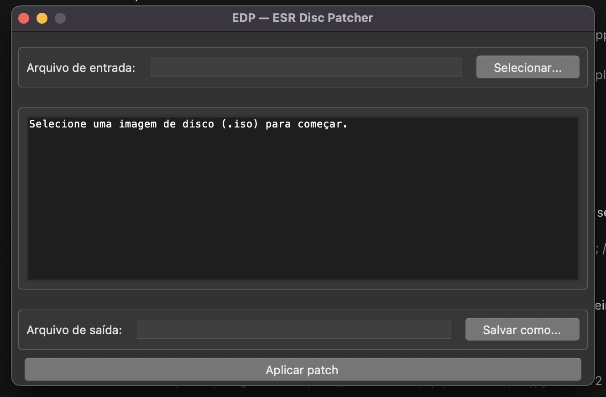

# EDP — ESR Disc Patcher

[](LICENSE)


Turn the ISO of your own PS2 game into a disc the console accepts and boots —
no modchip required.

**Languages:** [Português](README.pt-BR.md) · **English**

---

## Quick start

```bash
# 1) build the direct-boot image (ESR + FreeDVDBoot)
PYTHONPATH=src python3 -m edp fdvdb game.iso          # → game_fdvdb.iso

# 2) burn to a DVD-R at 4x, finalized and verified (macOS)
hdiutil burn -speed 4 -forceclose -verifyburn -noaddpmap -nosynth game_fdvdb.iso
```

3. Put the disc in the console and power it on. **No modchip.**

> **Burning** is the step that goes wrong the most — good media, **4x**,
> finalized and verified. Details in [Burning the disc](#burning-the-disc).

## What it is

**EDP** applies (and removes) the **ESR patch** on PlayStation 2 disc images
(ISOs). The console only accepts burned media if the disc presents itself as
something the drive recognizes — and that is exactly what EDP prepares. The
tool is a **backup, preservation and homebrew** utility: you hand it an ISO, it
produces a new image ready to burn, and the console boots it through the **ESR**
loader.

## How it works

Think of the disc as an **envelope**. The console does not read the contents: it
**inspects the envelope's label** and decides whether to accept it. EDP rewrites
that label (the disc _descriptors_) so the console treats it as a
**DVD-Video**, a gesture the drive recognizes. **The game executable is not
altered** — the game itself stays byte-for-byte as it was.

There are two boot paths:

- **Direct boot (ESR + FreeDVDBoot):** the disc embeds the exploit and the
  loader; the console boots **with no modchip and nothing installed**. (Requires
  hardware compatibility — see below.)
- **Classic mode:** the disc is accepted by the drive, but booting depends on
  the **ESR loader already being installed on the console** (for example, via
  FreeMcBoot).

By default **the original ISO is never modified**: the output is always a new
file. There is a destructive mode (`--in-place`), but it is optional and not the
default path.

## Responsible use

1. **Intended use:** backup and preservation of **your own discs** and running
   **homebrew**.
2. The tool **does not distribute protected content**: it embeds only homebrew
   scene components (with attribution — see *Third-party binary licenses*) and
   one structural block. It does **not** rip or download games.
3. The legality of backup and _format-shifting_ **varies by jurisdiction** — use
   it only where your local law allows.
4. **You are solely responsible** for your use of the tool.
5. **No compatibility guarantee.** The result depends on the console's model,
   firmware and region, and on the ESR loader being present (classic mode) or on
   direct boot being compatible with your unit.

## Requirements

EDP runs from the **same source** on macOS, Linux and Windows — **no
per-platform binary** and **no runtime dependencies** (Python standard library
only):

- **Python 3.9+** (the CLI works on any Python 3.9+).
- The **GUI** requires `tkinter` with **Tk ≥ 8.6**.

Per operating system:

- **macOS:** Python 3.9+. The system Python (`/usr/bin/python3`) ships Apple's
  **Tk 8.5**, broken on recent versions (the window opens empty) — for the GUI
  use an interpreter with Tk ≥ 8.6 (`brew install python-tk@3.12` or the
  [python.org](https://www.python.org/) installer).
- **Linux:** Python 3.9+. `tkinter` usually comes in a separate package for the
  GUI: `sudo apt install python3-tk` (Debian/Ubuntu),
  `sudo dnf install python3-tkinter` (Fedora) or `sudo pacman -S tk` (Arch).
- **Windows:** Python 3.9+ from
  [python.org](https://www.python.org/downloads/windows/) (check _tcl/tk and
  IDLE_); the GUI ships with Tk in the official installer.

Details and the full matrix in
[`docs/04-portabilidade.md`](docs/04-portabilidade.md).

> Examples use `python3`. On Windows use `py -3` (or `python`) instead — this
> applies to every command in this README.

## Installation

Nothing to install. Point `PYTHONPATH` at `src` and run straight from source:

```bash
PYTHONPATH=src python3 -m edp info game.iso
```

Or install it, which creates the `edp` and `edp-gui` commands on your `PATH`:

```bash
python3 -m pip install .        # install; use -e . for editable mode
```

## Usage — GUI

The GUI is the same on all three systems.



Step by step:

1. Start the interface (any of these):
   - `python3 run-gui.py` — direct (macOS / Linux / Windows);
   - `./run-gui.sh` (macOS / Linux) or `run-gui.bat` (Windows) — shortcuts;
   - `edp-gui` — if you installed with `pip install .`.
2. Click **Select...** and choose your ISO. The **diagnosis** appears
   automatically (UDF, patch state, game ID, region, boot ELF).
3. Check the suggested **output file** (default `<name>_fdvdb.iso`) and adjust
   with **Save as...** if you want.
4. Click **Apply patch** and watch the progress bar. The button produces the
   **direct-boot disc** (ESR + FreeDVDBoot), with payloads/loader already
   embedded — nothing to configure.
5. When done, the GUI shows the generated output and re-analyzes it. The
   **original ISO is always preserved** (the output is a new file).

Shortcuts and preferred interpreter:

```bash
./run-gui.sh                                          # macOS / Linux
run-gui.bat                                           # Windows
python3 run-gui.py --print                            # diagnosis only, no window
EDP_PYTHON=/path/to/python3 ./run-gui.sh              # macOS / Linux (force interpreter)
set EDP_PYTHON=C:\path\python.exe && run-gui.bat      # Windows (force interpreter)
```

On **macOS** there is also the `EDP.app/` bundle, a convenience to open the GUI
from Finder/Dock. It is **not self-contained or portable** and must stay at the
repository root — details in
[`docs/04-portabilidade.md`](docs/04-portabilidade.md).

## Usage — CLI

```bash
# Inspect the image without changing it (UDF, patch state, game id, ELF)
PYTHONPATH=src python3 -m edp info game.iso

# Apply the ESR patch, producing a new ISO (the original is preserved) — default
PYTHONPATH=src python3 -m edp patch game.iso -o game_esr.iso

# Build the direct-boot disc (ESR + FreeDVDBoot)
PYTHONPATH=src python3 -m edp fdvdb game.iso -o game_fdvdb.iso

# Remove the ESR patch (revert — CLI only; see the note below)
PYTHONPATH=src python3 -m edp unpatch game_esr.iso -o game_original.iso
```

Example diagnosis (`info` before and after patching):

```console
$ PYTHONPATH=src python3 -m edp info game.iso
Imagem:            4334649344 bytes (4133.8 MiB)
UDF:               sim (NSR02 @ setor 19)
Estado do patch:   clean
Volume ID:         GH3C
Game ID:           SLUS_216.72
Regiao:            NTSC-U
Boot executable:   SLUS_216.72
ELF:               32-bit=True, LE=True, MIPS=True, entry=0x103D08

$ PYTHONPATH=src python3 -m edp fdvdb game.iso
$ PYTHONPATH=src python3 -m edp info game_fdvdb.iso
Imagem:            4334649344 bytes (4133.8 MiB)
UDF:               sim (NSR02 @ setor 19)
Estado do patch:   patched
Volume ID:         GH3C
Game ID:           SLUS_216.72
Regiao:            NTSC-U
Boot executable:   SLUS_216.72
ELF:               32-bit=True, LE=True, MIPS=True, entry=0x103D08
```

Default outputs when `-o` is omitted: `patch` → `<name>_esr.iso`, `fdvdb` →
`<name>_fdvdb.iso`, `unpatch` → `<name>_unpatched.iso`. `patch` and `unpatch`
accept `--in-place` (destructive, modifies the file itself) and all accept
`--overwrite` (overwrites an existing output).

> **About `unpatch`:** it undoes the **ESR patch** (restores the descriptors and
> clears the DVD-Video area) — a perfect revert on ESR-only ISOs. It does **not**
> remove the **FreeDVDBoot** overlay (the payloads at LBA 138/145/151 remain).
> That is why it exists **on the CLI only**: the GUI always produces a new file
> and preserves the original, making unpatch unnecessary there.

## Direct boot (FreeDVDBoot + ESR)

Beyond the classic ESR patch — which depends on the ESR loader on the console —
EDP produces a **self-booting** disc combining ESR with the **FreeDVDBoot**
exploit. The burned disc boots on a PS2 **with no modchip and nothing
installed**, subject to the exploit's compatibility.

Exploit requirements (not the tool's):

- **Slim** → any (hybrid 3.10/3.11 payload); **Phat** → only 2.10, 2.12 and
  3.04;
- console set to **English**.

```bash
PYTHONPATH=src python3 -m edp fdvdb game.iso -o game_fdvdb.iso
```

The payloads/loader used are the ones **embedded in the package**. To use others
(for example, the **Phat** 2.10/2.12/3.04 firmware), the CLI accepts the
`--video-ts-ifo`, `--vts-01-0-ifo` and `--loader` flags, or an override folder
(`EDP_FDVDB_DIR` or `payloads/` next to the project); the embedded ones are the
default. The GUI detects the override folder automatically.

## Burning the disc

EDP hands you a **ready ISO**; burning is the final step — and **the one that
goes wrong the most**. Golden rule: **good media, 4x, disc finalized, with
verification**.

| System | How to burn |
|---|---|
| **macOS** | `hdiutil burn -speed 4 -forceclose -verifyburn -noaddpmap -nosynth "image.iso"` |
| **Linux** | `growisofs -dvd-compat -speed=4 -Z /dev/sr0="image.iso"` (or `xorriso`, K3b, Brasero) |
| **Windows** | **ImgBurn** (_Write image file to disc_) or the built-in "Burn disc image" |

Use **DVD-R** (not CD): the PS2 drive reads DVD. On macOS, `-noaddpmap -nosynth`
tell it to burn the bytes **as they are** — essential, because booting depends on
the exact layout of the first sectors; `-forceclose` **finalizes** the disc.

What usually goes wrong:

- **Disc left "open" (not finalized)** → no boot. **Finalize** the session.
- **Cheap media / high speed** → black screen. Use brand media at **4x**.
- **Unstable USB burner** → the burn fails or the disc comes out ejected.
  Reburn.

## Real hardware validation

The output has been **confirmed on a real console**: on **2026-10-17**, discs
produced with `edp fdvdb` **booted** on a **stock PS2, with no modchip and
nothing installed** (console set to `English`). This matches the exploit's
geometry — EDP touches only the first ~0.3 MB (LBAs 14–158) and the rest of the
ISO stays **byte-for-byte** identical to the original.

> If a disc does not boot, **most of the time it is not the tool** — it is the
> burn. Reburn (better media, 4x, verified) before opening an *issue*.

## Project status

- **Version:** `0.1.0` — stable for use.
- **Tests:** 91 automated (domain, ISO, integration) **+ real-hardware
  validation**.
- **Support:** macOS, Linux and Windows from the same code, **no runtime
  dependencies**.
- **Scope:** EDP **prepares the image**. It does not rip, does not download
  games and installs nothing on the console.

## FAQ and limitations

- **I burned it, but the console won't boot.** Check: the ISO was a valid PS2
  ISO9660+UDF game; in classic mode, the ESR loader is installed on the console;
  in direct boot, your model is in the supported list (Phat only 2.10/2.12/3.04)
  and the console is set to **English**.
- **It boots past the startup and hangs (black screen).** Almost always a
  **burn/media** issue: reburn on good media at 4x, **finalized** and verified,
  before blaming the patch.
- **The disc is large (~4 GB) and won't load.** Media holds ~4.38 GiB; nearly
  full discs rely on the laser reading the **outer tracks** well. Reburn on
  quality media and, if it persists, suspect the media/drive.
- **Classic mode vs. direct boot.** No loader on the console? Use `fdvdb`
  (direct boot). ESR loader already installed? `patch` is enough.
- **Removing the patch.** Only `unpatch` on the CLI undoes the ESR patch; it
  does not remove the FreeDVDBoot overlay.
- **No compatibility guarantee** across every model/firmware/region — we don't
  promise "works on any PS2".
- **The original ISO is preserved by default.** `--in-place` is destructive and
  exists only for those who know what they are doing.

## Technical reference

### The patch algorithm (ESR)

1. back up LBA 34 → 14 and LBA 50 → 15;
2. `bytes[188..190]` of the descriptors at LBAs 34 and 50 ← LBA 128;
3. recompute the **CRC-16/XMODEM** (bytes 8–9) and the UDF _tag_ checksum
   (byte 4);
4. write **24,576 bytes** (12 sectors) of DVD-Video structure at LBA 128.

"Already patched" marker: `+NSR` at `LBA 14 * 2048 + 25`. The whole region
touched is in the first ~288 KB (`128 * 2048 + 24576 = 286,720`), so the patch
is O(1) — no need to load the ISO's GBs. The game ELF and `SYSTEM.CNF` stay
intact. See [`docs/01-analise-do-problema.md`](docs/01-analise-do-problema.md)
and [`docs/adr/0002-alvo-do-patch-e-udf.md`](docs/adr/0002-alvo-do-patch-e-udf.md).

### Direct-boot overlay (FreeDVDBoot)

In one pass over the image: ESR patch → rename `VIDEO_TS.BUP` →
`VTS_01_0.IFO` → adjust the _short_ad_ → write the 3 files at
`0x45000`/`0x48800`/`0x4B800` (LBAs 138/145/151).

### Architecture

```
domain  → crc, elf, system_cnf, models, errors, constants, gameid
iso     → device (Protocol/File/Memory), udf, iso9660, inspector
patcher → descriptor, dvd_data, engine, service
cli/gui → presentation over the service
```

Dependencies always point downward; the `service` orchestrates copy and
progress and is the only port used by CLI and GUI. See
[`docs/03-arquitetura.md`](docs/03-arquitetura.md) and the decisions recorded in
`docs/adr/0001..0004`.

### Tests

```bash
PYTHONPATH=src python3 -m unittest discover -s tests -t . -v
```

They cover the domain (CRC, ELF, `SYSTEM.CNF`), the ISO layer (UDF, ISO9660),
the descriptor transform and a full integration flow
(`analyze → patch → analyze → unpatch`) over a synthetic ISO. The definitive
validation on real hardware is done manually and **has already been confirmed**
— see [Real hardware validation](#real-hardware-validation).

### Asset provenance

DVD-Video structure block embedded in the package:

- `src/edp/assets/dvd_video_data.bin` — 24,576 bytes, SHA-256
  `d61083e8bc90a959c21958e46216a8531c2095c2f6f780b779d9489f3fd5a845`.

FreeDVDBoot payloads/loader (`src/edp/assets/fdvdb/`, extracted from
`FDVDB_ESR_Patcher_v0.4` / "FreeDVDBoot Auto Patcher"):

- `payload_VIDEO_TS.IFO` — 14,336 bytes, SHA-256
  `e4a41769d71989ca40b4c64a79cf8c5b6b695cb1779af71cd2978f00329f37d6`
  (exploit recompiled with `LOAD_FROM_SECTOR_RELATIVE_TO_VIDEO_TS_IFO`, different
  from CTurt's repository);
- `payload_VTS_01_0.IFO` — 12,288 bytes, SHA-256
  `c26206e1e4f4405855495037eb725a9be0bb964d2d163fd712edd30e626fd3c0`;
- `esr.elf` — 14,921 bytes, SHA-256
  `dccbaaee464ced9bbd62f25db7c4e02b549be6f4e7705fddb5ff970ba1403fa4`
  (ffgriever's ESR loader, a valid PS2 ELF).

All versioned in the repository for reproducibility.

**Third-party binary licenses.** These blobs come from scene projects and are
redistributed **with attribution**, for reproducibility:

- **FreeDVDBoot** (CTurt) — the exploit payloads. The upstream project
  **declares no explicit license**; if you need legal clarity, use the override
  folder (`--loader` / `--video-ts-ifo` / `--vts-01-0-ifo` or `EDP_FDVDB_DIR`)
  and supply the payloads yourself.
- **ESR** (ffgriever) and **esr patch** (bootsector) — the patch logic and the
  ESR loader. Scene freeware, with no formal license.
- `dvd_video_data.bin` — DVD-Video structural block used by ESR patchers so the
  disc presents itself as DVDV.

The **EDP code itself** is GPL-3.0-or-later; the caveats above apply only to the
redistributed binaries.

### Icon

`src/edp/assets/icons/` — the disc's **data side** (the gray part the laser
reads), in grayscale pixel art (32×32 grid, black outline, diagonal sheen and a
hub with a center hole): `icon.svg` (vector, for editing),
`edp_16/32/128/256/512/1024.png` (with alpha; the 128 one is used by the GUI's
`iconphoto`), `edp.ico` (Windows) and `edp.icns` (macOS). Drawn by the project
(GPL-3.0); it uses no PlayStation logo/trademark.

The GUI applies the icon per system: **Windows** uses `edp.ico` via
`iconbitmap`; **macOS/Linux** use `edp_128.png` via `iconphoto`; if any asset is
missing, the GUI still opens normally (the icon is cosmetic). On macOS the
Dock/Finder icon comes from the `EDP.app/` bundle. See `src/edp/gui/app.py` and
[`docs/04-portabilidade.md`](docs/04-portabilidade.md).

## Contributing

Suggestions, fixes and *issues* are welcome — see
[`CONTRIBUTING.md`](CONTRIBUTING.md).

## Credits and license

Distributed under the **[GPL-3.0-or-later](LICENSE)**.

Idea and ESR patch inspired by the reference open-source PS2 scene tools:
**ffgriever** (ESR), **bootsector** (esr patch), **CTurt** (FreeDVDBoot),
**ali-raheem** (esrtool) and **James Pelster** (OpenESRDiscPatcher).
